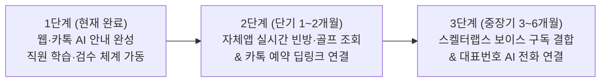

# [PPT 제작용 마스터 문서] 벨포레 리조트 AI CS 구축 현황 및 향후 로드맵
> **문서 작성 원칙**: 과장이나 장밋빛 전망을 배제하고, **실제 구현 완료된 기능**, **실측된 서버/DB 수치**, **현재의 명확한 기술적 한계**, **외부 전문 솔루션(스켈터랩스 등) 대비 냉정한 장단점**, 그리고 **현실적인 단계별 계획**만을 기록함.

---

## [Slide 1] 표지 및 핵심 요약 (Executive Summary)
* **제목**: 벨포레 리조트 자체 AI CS 플랫폼 구축 현황 및 향후 고도화 계획
* **부제**: 외주 솔루션 임대 방식에서 ‘자체 지식 자산화 및 현장 주도형 AI 운영’으로의 전환
* **핵심 요약 3줄**:
  1. **현재 달성 수준**: 리조트 내 **55개 핵심 시설·식음·골프·숙박·회원혜택 지식 DB 구축 완료** 및 **웹·카카오톡 실시간 AI 응대(평균 1.6~2.0초)** 가동 중.
  2. **핵심 차별점**: 개발자가 아닌 **현장 직원이 직접 1분 만에 수정·학습·검수**할 수 있는 전용 관리자 시스템 구축 (유휴 시간 서버 대기 비용 `0원`).
  3. **남은 과제**: 현재는 ‘안내 및 규정 응답’ 단계이며, 향후 **① 자체 앱(숙박·골프) 실시간 빈방/예약 API 연동**, **② 스켈터랩스 보이스 구독 결합을 통한 대표번호 전화(ARS) 응대 확장**이 단계적으로 필요함.

---

## [Slide 2] 왜 자체 구축을 선택했는가? (배경 및 문제의식)
* **리조트 CS 현장의 특수성**:
  * 일반 쇼핑몰과 달리 리조트는 **날씨(우천 휴장), 시즌별 요금, 코스별 신장 제한, 기명/무기명 회원 할인율** 등 현장 변수가 매일 발생함.
  * 기존 방식(단순 시나리오형 챗봇 또는 외주 솔루션)은 현장 상황이 바뀔 때마다 시나리오 트리를 고쳐야 해서 **현장 직원이 즉시 수정하기 불가능**했음.
* **우리의 목표**:
  1. 손님에게는 **1~2초 내 정확한 핵심 정보(요금·시간·키 제한·우천 여부)**를 즉답하고,
  2. 예약·환불·컴플레인 등 **직원이 꼭 개입해야 할 질문만 상담원에게 정확히 연결**하며,
  3. 현장 직원이 쉽게 데이터를 고치면 **미래 안내 로봇·콜센터까지 동시에 쓸 수 있는 표준 DB**를 회사 자산으로 축적하는 것.

---

## [Slide 3] 현재 우리의 실제 기술 수준 및 구축 현황 (Fact Sheet)
> ※ 2026년 10월 18일 실제 운영 서버 및 DB 실측치 기준 (추정치 없음)

| 구분 | 현재 구축된 실제 사양 및 수치 | 비고 (작동 상태) |
| :--- | :--- | :--- |
| **AI 엔진** | Google `gemini-flash-lite-latest` + `gemini-embedding-001` (768차원) | 상용 가동 중 |
| **지식 데이터베이스** | Firestore + Pinecone Serverless (`belleforet-cs` 인덱스 1:1 동기화) | **승인 지식 55건 / 유령 벡터 0건** |
| **로봇 호환 규격** | 전 시설 55건(`100%`)에 7대 정형 스펙(`robotSpecs`: 시간·휴무·요금·위치·키제한·우천·반려견) 탑재 | 로봇/키오스크 즉시 연동 가능 |
| **응답 속도 (실측)** | 전체 답변 완성 **1.58초 ~ 2.03초** (첫 글자 표출 **약 0.8초**) | 카톡 3.5초 타임아웃 방어막 적용 |
| **인프라 비용 구조** | 100% Serverless On-Demand (Vercel + Pinecone OnDemand + Firestore) | **야간/유휴 대기 기본료 `0원`** (질문 1,000건당 원가 약 150원) |
| **자동화 파이프라인** | 매일 아침 공식 홈페이지(`belleforetresort.com`) 특가 패키지·식음 12곳·골프 요금 자동 동기화 | 종료된 패키지 자동 만료 격리 |

---

## [Slide 4] 현재 100% 작동하는 기능 (What Works Now)

### 1. 고객 응대 채널 (웹 챗봇 & 카카오톡 채널)
* **정확한 시설/규정 즉답**: 55개 시설의 운영시간, 이용요금, 할인율, 탑승 키 제한 안내.
* **리조트 전용 동의어 뇌**: 고객이 구 명칭(`"익스트림 루지"`)이나 오타로 질문해도 현재 명칭(`"마운틴카트"`)으로 자동 변환해 코스별 요금 안내.
* **카카오톡 상담원 연결 버튼 정밀 제어**:
  * 단순 시간/요금 질문 시에는 상담원 연결 버튼을 숨겨 콜센터 업무 과중 방지.
  * **예약·취소·환불·분실물·불만·미등록 정보** 질문 시에만 `[💬 상담원 연결하기]` 버튼 자동 노출.

### 2. 현장 직원용 관리자 시스템 (`/admin` 4대 메뉴)
* **[메뉴 1 · AI 지식창고]**: 7개 빈칸(운영시간·휴무일·요금·키제한·우천·반려견·전화번호)만 채우면 AI 표준 문서로 자동 조립 + **저장 전 기존 DB와 숫자 충돌 여부를 잡아내는 AI 사전 팩트체크**.
* **[메뉴 2 · 오늘의 긴급 공지]**: 당일 우천 휴장 등록 시 챗봇이 1순위로 안내. 직원이 종료일을 안 적어도 **본문 속 날짜(`10월 25일` 등)를 AI가 자동 인식해 기한이 지나면 자동 차단** 및 일괄 삭제.
* **[메뉴 3 · 통합 인박스 & 카톡 학습]**: AI가 대답 못 한 질문(오답노트) 원클릭 정답 교육, 카톡 대화록 복사-붙여넣기 자동 흡수, 불필요한 쓰레기 질문 영구 완전삭제.
* **[메뉴 4 · AI 말투 설정]**: 호텔리어 모드 / 핵심 요약 모드 / 테마파크 가이드 모드 / 외국인 영어 모드 즉시 전환.

---

## [Slide 5] 냉정한 현실 진단: 현재 안 되는 것과 한계점 (Limitations)
> ※ 경영진 및 실무진이 반드시 알고 있어야 할 현재 시스템의 한계

1. **실시간 예약 및 빈방/잔여 티타임 조회 불가 (가장 큰 한계)**
   * **현실**: 현재 AI는 *"콘도 요금이 얼마인가요?"*, *"골프장 그린피가 얼마인가요?"*에는 정확히 답하지만, *"이번 주 토요일 35평 빈방 있나요?"* 또는 *"지금 바로 예약해 주세요"*는 처리하지 못함.
   * **원인**: 회사 자체 예약 앱(PMS/골프 전산)의 실시간 재고 DB와 아직 API가 연결되어 있지 않음.
2. **카카오톡 상담원 1:1 채팅 내역의 ‘완전 자동’ 수집 한계**
   * **현실**: 상담원이 카카오톡 채팅방에서 손님과 직접 타이핑해 나눈 대화는 카카오 보안 정책상 외부 서버로 자동 전송되지 않음.
   * **현재 방식**: 직원이 주기적으로 대화 내용을 관리자 앱에 복사-붙여넣기 하거나, AI가 못 답한 질문 목록에서 정답을 입력해 주는 **반자동(Human-in-the-Loop) 방식**임.
3. **실제 전화선(대표번호 ARS) 미연결**
   * **현실**: 우리 서버 안에 전화 응대용 AI 프로그램(`/api/voice/webhook`)은 이미 만들어져 있으나, 실제 리조트 전화번호(`1566-0162`) 통신망과 연결하는 보이스 중계 설정은 아직 진행 전임.
4. **현장 직원의 업데이트 참여 필수**
   * 홈페이지에 올라오지 않는 현장 돌발 상황(갑작스러운 기계 점검, 임시 휴장 등)은 직원이 관리자 앱에 1줄이라도 올려주어야 AI가 거짓말을 하지 않음.

---

## [Slide 6] 외부 전문 AI 기업(스켈터랩스 등) vs 우리 앱 객관적 비교
> ※ 무조건 우리가 좋다는 식이 아닌, 영역별 냉정한 장단점 비교

| 비교 영역 | 외부 전문 솔루션 (스켈터랩스 등 B2B 벤더) | 우리 자체 구축 앱 (벨포레 AI CS) | 냉정한 평가 (승패) |
| :--- | :--- | :--- | :---: |
| **초기 도입비 및 월 유지비** | 초기 구축 수천만 원 + 월 수십~수백만 원 구독료 | **구축 수수료 0원, 대기료 0원, 월 실비 수천 원 수준** | **우리 앱 압승** |
| **현장 직원 사용 편의성** | 범용 챗봇 빌더(복잡한 시나리오 트리)로 교육 필요 | **벨포레 전용 7칸 빈칸·원클릭 우천 공지**로 즉시 사용 | **우리 앱 우위** |
| **기능 수정 및 반영 속도** | 기능 추가 시 견적 요청 ➔ 계약 ➔ 수주일 소요 | **내부에서 당일 즉시 수정·배포 가능** | **우리 앱 압승** |
| **데이터 소유권 및 로봇 연동** | 벤더사 포맷에 종속 (타사 로봇 연동 시 추가 비용) | **100% 자체 DB 소유 (`robotSpecs` 표준화 완료)** | **우리 앱 우위** |
| **대규모 콜센터 음성(STT) 기술** | **자체 음성인식 엔진 및 통신사 PBX 구축 경험 풍부** | 외부 보이스 구독 서비스 결합 필요 | **전문 기업 우위** |
| **24시간 전담 장애 관제 인력** | 벤더사 전담 엔지니어 및 콜센터 기술지원팀 보유 | 내부 담당자 중심 관리 (클라우드 서버 자체는 무중단) | **전문 기업 우위** |

---

## [Slide 7] 외부 전문 회사와 비교 시 우리의 강점과 약점 요약

### 👍 우리의 확실한 강점 (Why Keep Our App)
1. **압도적인 가성비**: 스켈터랩스 같은 전문 솔루션을 전체 도입하면 매년 수천만 원의 고정비가 나가지만, 우리는 글로벌 빅테크(Google Gemini + Pinecone) 원가만 내므로 **비용이 1/100 이하**임.
2. **벨포레 맞춤형 현장성**: 우천 휴장 공지 자동 만료, 홈페이지 패키지 자동 크롤링, AI 사전 팩트체크 등 **리조트 실무에 꼭 필요한 기능만 군더더기 없이 직관적으로 구현**됨.
3. **미래 자산 독점**: 축적된 모든 질문 로그와 55개 시설의 정형 데이터(`robotSpecs`)가 외주업체가 아닌 **벨포레 자체 DB에 100% 남음**.

### 👎 우리의 약점 및 보완책 (How to Overcome Weaknesses)
1. **통신/전화망 직접 구축 능력 부족**
   * **보완책**: 전화 음성인식(STT)이나 통신망을 우리가 직접 개발할 필요 없이, **두뇌는 우리 앱을 그대로 쓰고 전화 음성 처리 영역만 스켈터랩스 등 전문 기업의 보이스 구독 서비스를 결합하면 해결**됨.
2. **예약 전산(PMS/골프) 연동 개발 필요**
   * **보완책**: 회사 자체 앱 개발팀(전산팀)의 예약 API 문서만 확보하면 우리 AI 서버에 직접 연결 가능.

---

## [Slide 7-2] 전화(Voice) 영역 확장 전략: 자체 구축 DB와 스켈터랩스 보이스 구독의 하이브리드 결합
* **상단 헤드라인 문장 (Key Message)**:
  > **"핵심 지식 DB와 관리자 시스템은 우리 자체 앱으로 영구 소유하고, 까다로운 전화 음성(STT·TTS) 처리만 스켈터랩스의 구독형 서비스로 결합하는 것이 가장 경제적이고 현실적인 방안입니다."**

* **본문 핵심 문장 3가지**:
  1. **전화 통화만의 기술적 한계(소음·발음·통신망)를 검증된 기술로 즉시 해결**
     * 문자(카카오톡·웹)와 달리 실제 전화 통화는 주변 소음, 사투리, 고령 고객의 불명확한 발음, 말 도중 끼어들기 등 고난도 음성 처리 기술이 필수적입니다.
     * 이를 자체 개발하며 시행착오를 겪는 대신, 한국어 음성인식(STT)과 콜센터 통신망 연동 기술이 검증된 **스켈터랩스의 보이스 기능을 구독 형태로 활용**하면 통화 품질을 즉시 상용 수준으로 확보할 수 있습니다.
  2. **명확한 역할 분담: [귀와 입은 스켈터랩스] + [두뇌와 기억은 벨포레 자체 앱]**
     * **스켈터랩스(귀·입 역할)**: 고객의 전화를 받아 말소리를 정확히 텍스트로 변환하고, 자연스러운 음성으로 끊김 없이 대답을 읽어주는 ‘음성 통로’ 역할을 담당합니다.
     * **벨포레 자체 앱(두뇌·DB 역할)**: 현장 직원이 매일 관리하는 55개 시설 지식창고, 당일 우천 휴장 공지, 향후 연동될 자체 앱 빈방/골프 재고 데이터를 바탕으로 ‘정확한 답변’을 내려줍니다.
  3. **거액의 초기 구축비 없이 필요한 시점에 유연하게 구독(SaaS) 운영**
     * 처음부터 수천만 원 규모의 콜센터 시스템을 통째로 외주 구축할 필요 없이, 현재 완성된 웹·카톡 AI로 데이터 정확도를 충분히 다진 뒤 **전화 문의가 집중되는 성수기·주말 중심으로 스켈터랩스 보이스 구독을 결합**하여 투자 비용을 최소화합니다.

* **하단 결론 요약 문장 (Bottom Line)**:
  > **"외주 업체에 데이터와 시스템을 종속시키지 않으면서도, 전화 응대 품질만 전문 기업(스켈터랩스)의 구독형 보이스 기술로 보완하는 가장 안전한 실속형 전략입니다."**

---

## [Slide 8] 향후 추진 로드맵 (3단계 현실적 계획)

### 📍 Phase 1: 지식 안내 완전자동화 및 현장 정착 (현재 100% 완료)
* 55개 시설/규정 DB 구축 및 웹·카카오톡 AI 응대 가동
* 직원용 관리자 앱(AI 팩트체크, 긴급공지 자동만료, 쓰레기 데이터 완전삭제, 데스크탑 UI 최적화) 구축 완료
* **당면 과제**: 현장 직원들이 당일 우천 휴장 및 신규 지식을 관리자 앱에 직접 입력하는 실무 운영 정착 (2주간 실사용 모니터링)

### 📍 Phase 2: 회사 자체 앱(숙박·골프) 예약 연동 (단기 핵심 목표)
* **Step 2-1 (조회 연동 — 성공 확률 95%)**:
  * 회사 자체 앱의 **‘빈방 조회 API’ 및 ‘골프 잔여 티타임 조회 API’**를 우리 AI 서버에 연결.
  * 손님이 카톡에서 *"이번 주 토요일 빈방 있어?"* 질문 시 실시간 잔여 객실 수와 가격을 안내하고 **`[📲 자체 앱에서 바로 예약하기]`** 버튼 연결.
* **Step 2-2 (카톡 내 예약 접수 — 성공 확률 85%)**:
  * 분양회원 또는 전화번호 인증 고객이 카톡 대화만으로 실제 예약 번호를 발급받도록 **‘예약 생성 API’** 연동.

### 📍 Phase 3: 스켈터랩스 보이스 구독 결합 및 안내 로봇 납품 (중장기 목표)
* **대표번호 ARS + 보이스 구독 결합**: 리조트 대표번호(`1566-0162`) ARS 단순 문의(시설/요금/휴장)를 스켈터랩스 보이스 구독 엔진을 통해 우리 앱(`/api/voice/webhook`)과 연결 + 통화 직후 상세 요금표 자동 문자 발송.
* **리조트 안내 로봇 연동**: 이미 구축 완료된 55개 시설의 `robotSpecs` API(`/api/admin/robot-dataset`)를 로비 안내 로봇에 그대로 공급하여 추가 DB 구축비 `0원` 달성.

---

## [Slide 9] 목표 달성을 위해 회사(타 부서) 협조가 필요한 사항
> ※ PPT 발표 시 의사결정권자에게 요청할 핵심 안건 3가지

1. **[전산팀 / 자체앱 담당 부서] 숙박·골프 조회 및 예약 API 공유 요청**
   * 자체 앱이 사용하고 있는 **① 객실 재고 조회 API, ② 골프 티타임 조회 API, ③ 예약 생성 API 명세서 및 접속 키(API Key)** 제공 협조.
2. **[현장 운영팀 / CS팀] 관리자 앱 일일 운영 루틴 지정**
   * 우천 휴장 등 현장 변동 발생 시 **[메뉴 2 · 오늘의 긴급 공지]**에 1분 내 등록하는 담당자 지정.
   * 주 1회 **[메뉴 3 · 통합 인박스(오답노트)]**를 확인하여 AI가 몰랐던 질문을 승인·학습시키는 루틴 정착.
3. **[통신/총무팀] 대표번호 ARS 착신전환 및 보이스 구독 연동 협조 (Phase 3 진행 시)**
   * 단순 운영시간/요금 문의 전화를 AI 보이스 웹훅 번호로 분기하기 위한 ARS 번호 설정 협조.
